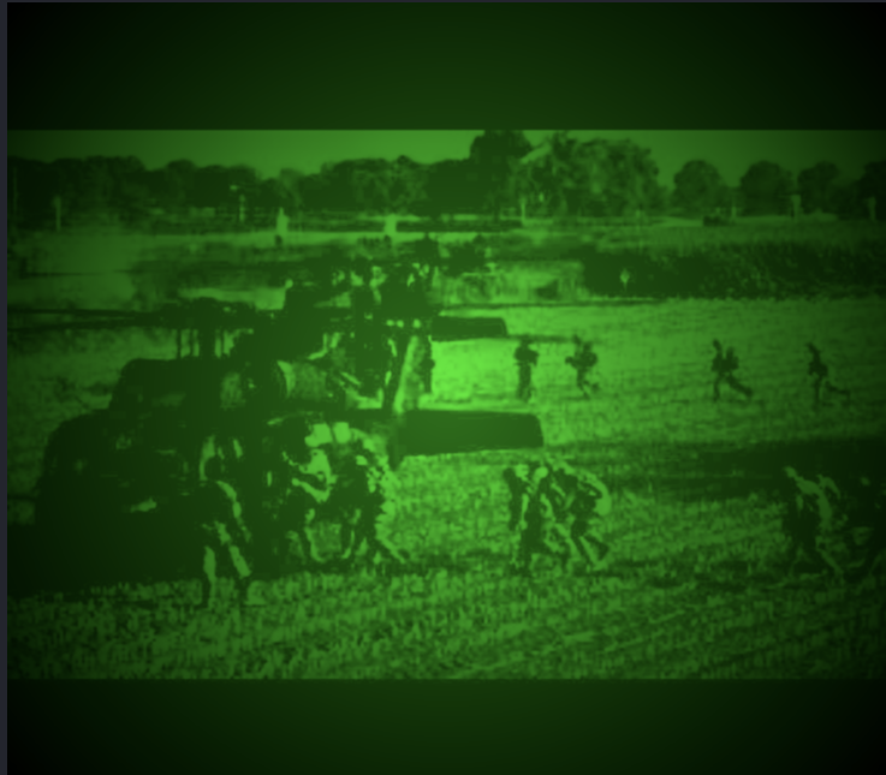
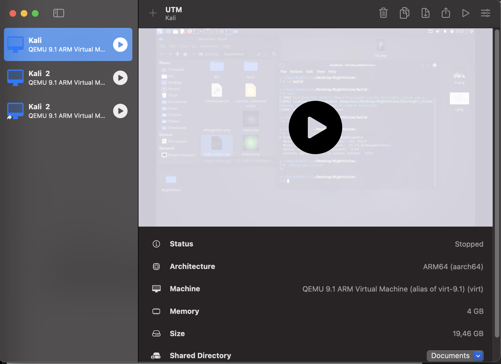
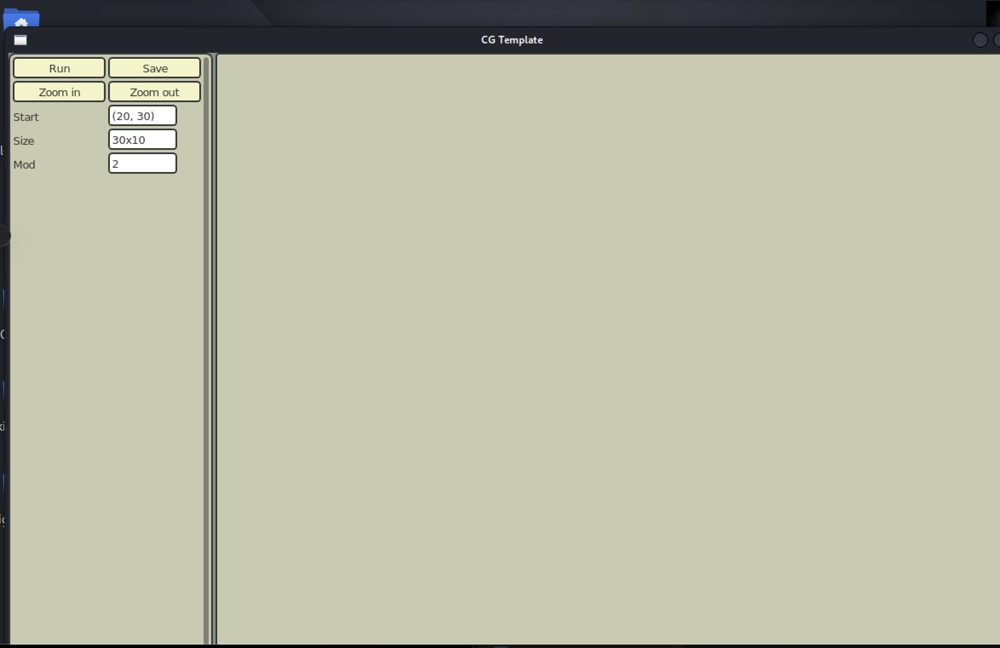
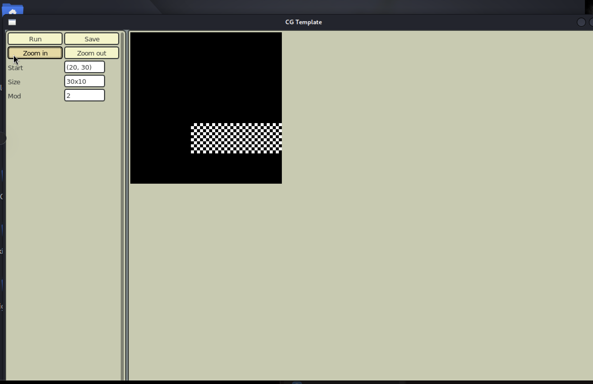
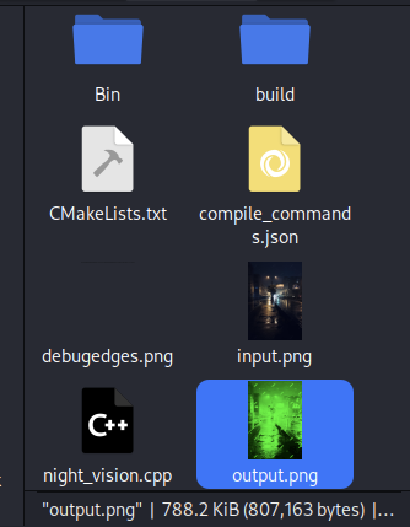
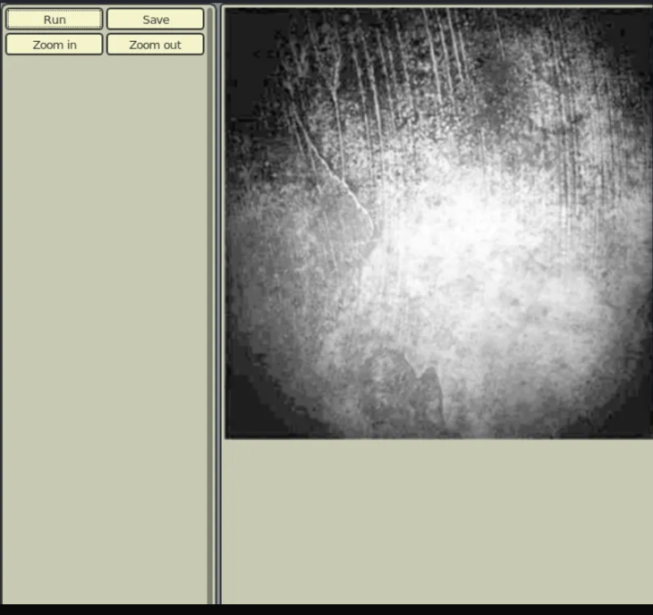
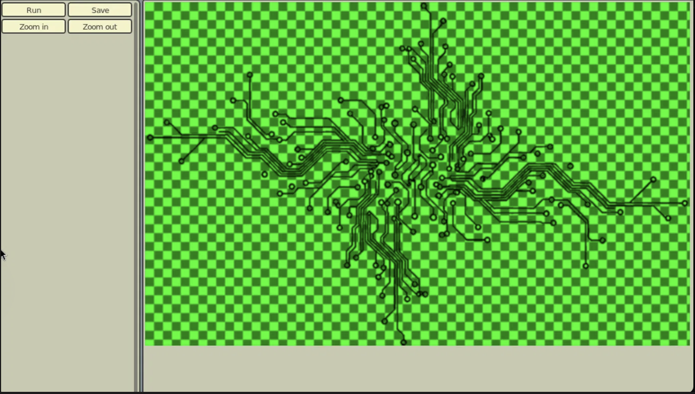
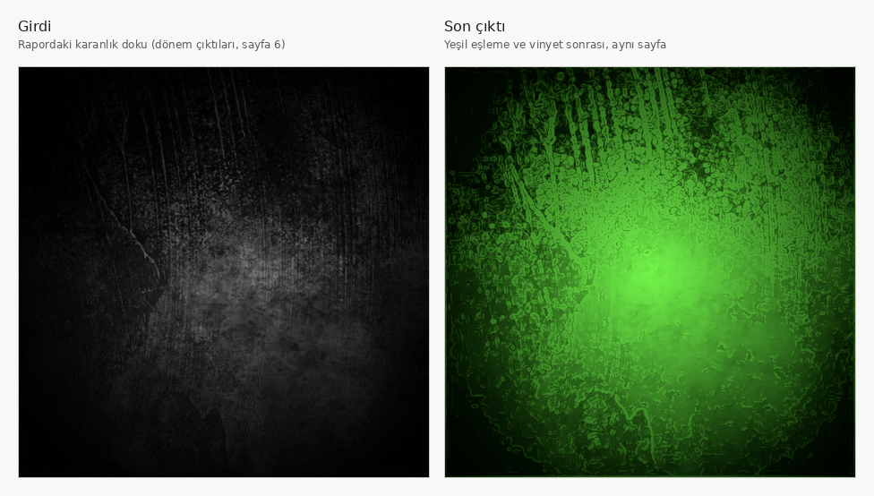
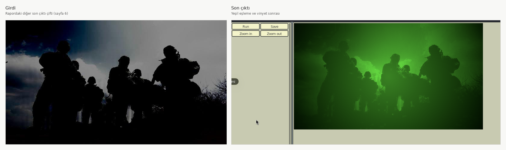
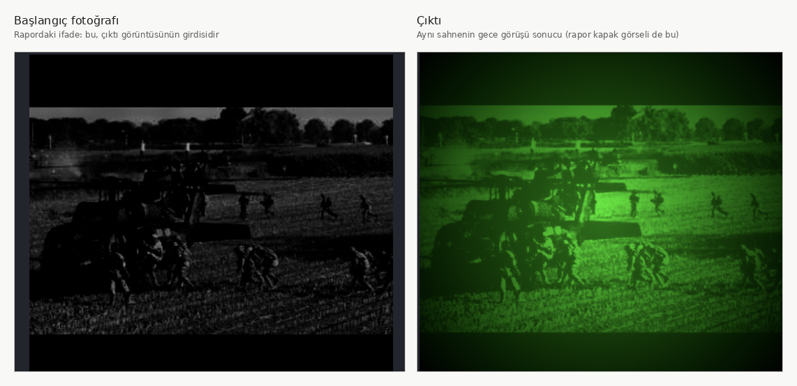

# Gece görüşü benzetimi

Lefke Avrupa Üniversitesi'nde 2026 yılında aldığım Principles of Digital Image Processing dersinin dönem projesi. Amaç, gerçek gece görüş gözlüklerine benzeyen bir çıktı üretmek. Raporda da yazdığım gibi gerçek cihazlar X-ışını, morötesi veya kızılötesi kullanır; bu program aynı görünümü, elindeki bir fotoğraf üzerinde ardışık görüntü işlemleriyle yaklaşıyor.

Çalışma Gorgon (Advanced Library) ile C++ içinde yazıldı. Ayçiçeği projesindeki gibi macOS sorunu vardı; kurulumu UTM üzerinde Kali Linux ile yaptım. Ayrıntılar ve aşağıdaki görseller dönem raporundan alınmıştır. Raporun bu kopyasında öğrenci numarası ve öğretim üyesi adı çıkarılmıştır.

Raporun açılışındaki hedef çıktı şöyleydi: işlemlerden sonra girdi görüntüleri buna benzer görünmeliydi.



## İşlemler neden bu sırada

Hocanın izniyle bir ek özellik de ekledim. İşlem sırası ve gerekçeleri raporda şöyle:

1. Sınırlama (clamping), 8 bit / 0–255. Negatif değerler 0'a, 255'i aşanlar 255'e çekilir. Geçerli aralığın dışına taşmayı önler.
2. Gri tonlama. Formülü ders notlarından aldım: `L = 0.2126*R + 0.7152*G + 0.0722*B`. İnsan gözü kırmızı, yeşil ve maviyi farklı parlaklıkta algılar; bu katsayılar onu yansıtır. Sonuç üç kanala da yazılır.
3. Histogram eşitleme. Histogram, olasılık dağılımı (pdf), kümülatif dağılım (cdf) ve bir yer değiştirme tablosu. Bu da ders notlarında vardı, adım adım uyguladım. Her pikselin yoğunluğu 0–255 aralığına yayılır. Karanlık görüntüleri okunur kıldığı için proje için önemli bir adımdı.
4. Gauss bulanıklaştırma. Toplam ağırlık 16. Ders notlarında Gauss'un basit bir kutu süzgecinden daha iyi olduğu yazıyordu, bu yüzden 3x3 çekirdek kullandım. Görüntü yumuşar. Çekirdek `[[1,2,1],[2,4,2],[1,2,1]]` şeklindedir. Kenarda taşan pikseller en yakın komşuya çekilir. Sonuç önce geçici bir kopyaya yazılır, sonra geri kopyalanır; doğrudan üzerine yazınca görüntü bozuluyordu.
5. Yeşil eşleme, gerçekçi bir gece görüşü için: `R=0`, `G=yoğunluk`, `B=0`, `A=255`. Bu gözlüklerin yeşil görünmesinin sebebi, insanın yeşili en parlak algılamasıdır.
6. Vinyet, dürbün gibi bir görünüm için. Kenarlar karartılır, orta kısım yeşil eşlemedeki gibi kalır. Çarpan: `1 - (uzaklık / maxUzaklık) * şiddet`. Şiddet 1.0 iken köşelerde yeşil kanal tamamen azalır. Bu adımı öğretim üyesiyle konuştuktan sonra, araştırma izniyle ekledim. Hesapta `sqrt(cx*cx+cy*cy)` ve `sqrt(dx*dx+dy*dy)` kullanılır; bunun için `cmath` gerekir.

Bu işlemlerle program, gece görüşü görünümünü üretir. `input.png` okunur, adımlar sırayla uygulanır, sonuç hem ekrana çizilir hem `output.png` olarak kaydedilir.

## Kurulum

Kurulum, ayçiçeği projesine çok benziyor. macOS Gorgon'u desteklemediği için önce UTM'i kurdum, içine Linux dağıtımları yükledim. Çökme ve iç hatalardan sonra proje için en uygun dağıtımın Kali olduğunu gördüm; diğerleri düzgün çalışmıyordu. Gerekli grafik kütüphanelerini ve eklentileri kurdum.



Gerekli kurulumlardan sonra Gorgon sanal makinede çalıştı:



## Deneme çıktıları

Görseller dönem raporundaki deneme anlatımından alınmıştır.

İşlemleri uyguladım, program çalıştı, ama arayüzde bir sorun vardı. Çıktı dosyaya yazılıyordu, pencerede görünmüyordu. Bunu öğretim üyesine sordum, ayarları değiştirip projeyi yeniden hazırladım. Kenar hata ayıklama (debug the edges) denemesi doğru çalışmadığı için o kısmı kaldırdım.





Arayüzü düzelttikten sonraki görüntü, henüz yeşil eşleme ve vinyet yokken:



Vinyet öncesi: köşelerde kararma yok. Bu da iyi duruyordu ama gece görüş gözlüğüne benzemiyordu.



Öğretim üyesiyle görüşüp biraz araştırdıktan sonra köşelere vinyeti ekledim. Raporda bunun gece görüş gözlüğüne benzediğini ve projenin son çıktıları olduğunu yazdım. Aynı bölümdeki girdi–çıktı çiftleri aşağıda, rapordaki haliyle yan yana alınmıştır.

Karanlık doku:



Rapordaki diğer son çıktı çifti:



Raporda, “başlangıçtaki fotoğraf benim çıktı görüntümdür” diye yazdığım çift. Bu çıktı aynı zamanda raporun açılış görselidir:



## Eklediğim iki ayrıntı

İkisini de öğretim üyesinin izniyle ekledim.

Birincisi, arayüz kurulunca `Run()` kendiliğinden çağrılır. Programı her seferinde elle başlatmak gerekmez.

İkincisi, gri tonlu PNG dosyaları uygulamada açılmıyordu. Bunun için `input.png` okunmadan önce şu dönüşüm çalışır:

```bash
convert input.png PNG32:input.png
```

Kodda bu, `system("convert input.png PNG32:input.png 2>/dev/null");` olarak geçer ve `cstdlib` ister. Görüntü 32 bit RGBA'ya çevrilir. ImageMagick gerekebilir; birçok Linux kurulumunda zaten vardır, ben ayrıca bir şey kurmadan çalıştırabildim.

## Ne öğrendim

Linux ve C++ tarafı bu işle belirgin şekilde ilerledi. Öğretim üyesiyle hem postayla hem okulda konuştum. Bu tür gözlüklerin neden yeşil olduğunu, neden kırmızı olmadığını, sınırlama, histogram eşitleme, gri tonlama, Gauss bulanıklaştırma, yeşil eşleme ve vinyetin neden gerektiğini buradan daha iyi anladım. Bazen tam işlemi veya sözdizimini bulamadım, bazen sıraya karar veremedim; arayıp sorup uyguladım.

## Kurulum ve derleme

Gorgon gerekir: https://github.com/darkgazeorg/Gorgon

Çalışma klasörüne bir `input.png` koyun (depoda deneme için üretilmiş koyu bir örnek var). Sonra:

```bash
mkdir build && cd build
cmake ..
# Gorgon başka bir klasördeyse:
# cmake .. -DGORGON_ROOT=/path/to/Gorgon
make
cd ..
./build/night_vision
```

Pencerede Run, Save, Zoom in ve Zoom out düğmeleri var. Açılışta işlemler kendiliğinden çalışır. Çıktı `output.png` olarak kaydedilir.

Bu taslağı hazırlarken ortamda Gorgon yüklü değildi, programı burada yeniden derleyip çalıştıramadım. Yukarıdaki görseller kendi Kali ortamımdaki dönem çıktılarıdır.

## Dosyalar

- `night_vision.cpp` — seçilen kaynak. Klasörde üç kopya vardı. `night_vision.cpp` (19 Mayıs 15:18) yapıcı fonksiyonu kapatmayan bir yazım hatası içeriyordu. Birkaç dakika sonraki `night_vision kopyası.cpp` ile raporu olmayan kopya aynıdır ve `Run();}` ile yapıcıyı kapatır. Depoya bu düzeltilmiş sürüm kondu; kapanış ayracı okunaklı olması için ayrı satıra alındı. Öğrenci numarası yorumlardan ve pencere başlığından çıkarıldı.
- `input.png` — çalıştırmak için üretilmiş örnek bir koyu görüntü. Rapordaki test fotoğrafları `docs/figures` altında, rapor sayfalarından çıkarılmış haliyle duruyor.
- `CMakeLists.txt` — derleme dosyası. Orijinal ödev klasöründe yoktu.
- `docs/Night-Vision-Report.pdf` — dönem raporu (öğrenci numarası ve öğretim üyesi adı çıkarılmıştır)
- `docs/figures/` — raporun deneme ve sonuç görselleri, girdi–çıktı karşılaştırmaları dahil

## English

This is my Principles of Digital Image Processing term project at the European University of Lefke (2026). It turns an `input.png` into a night-vision-like image in C++ with the Gorgon library.

The pipeline, as described in the report, is: clamp to 0–255; convert to grayscale with the lecture luminance weights (0.2126, 0.7152, 0.0722); histogram equalization (histogram, pdf, cdf, replacement table), which was important for reading dark images; a 3x3 Gaussian blur whose weights sum to 16; green mapping (`R=0`, `G=intensity`, `B=0`, `A=255`), because the human eye is most sensitive to green; and a vignette, `1 - (distance / maxDistance) * strength` with strength 1.0, added with the instructor's permission so the result looks more like a scope. The program also converts the input to 32-bit RGBA with ImageMagick before loading (`convert input.png PNG32:input.png`) and calls `Run()` automatically after the window is built.

Gorgon is not supported on macOS. After trying other distributions in UTM I used Kali Linux. The first working run wrote `output.png` but did not show the image in the UI; after I asked the instructor I fixed the window. A debug-edges attempt did not work and was removed. The report then shows the image before green mapping and vignette, the image after green mapping but before vignette (corners still bright), and the final outputs after vignette. The figures in `docs/figures` are taken from those pages, including side-by-side pairs of the report's own test images. The opening figure in the report is one of those final outputs.

Build with CMake after installing Gorgon. The student number and the instructor's name have been removed from this copy of the report. I could not rebuild the program in the draft environment because Gorgon was not installed there.
